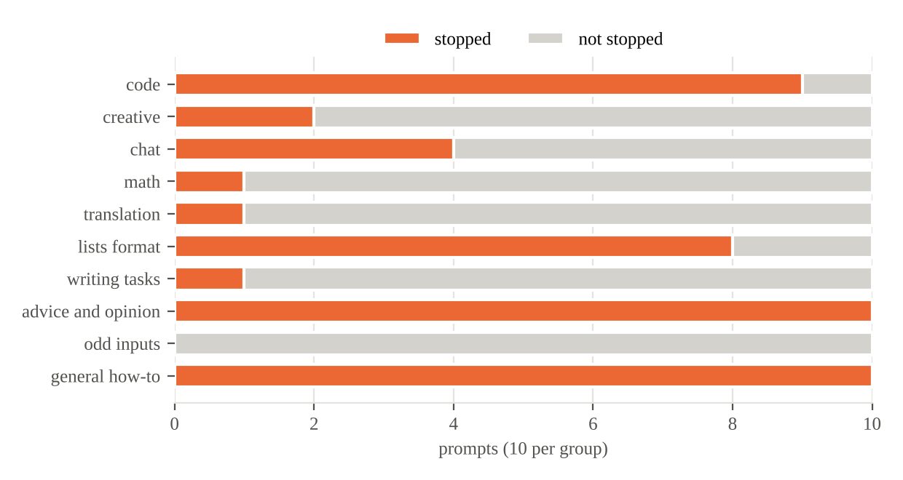

# Unfamiliar prompts: does the controller stop where it should not?

Paper: Section 6.9, "Behavior on unfamiliar prompts".

## Question
The controller keeps generating when the probe is not confident. That cannot help when the probe is confidently wrong. We ran 100 prompts that are unlike the training data and looked at how often the controller stops and how much of the answer it cuts.

## Setup
- Raspberry Pi 5, Llama-3.2-1B-Instruct Q4_K_M, same program and probe as in the main experiments (`src/controller/sp_controller.cpp`, `probe_v3.txt`).
- Threshold 0.99, check at every second sentence end, limit of 800 tokens.
- 100 prompts, 10 in each of ten groups: code, creative writing, chat, math, translation, lists and formats, writing tasks, advice and opinion, odd inputs, and general how-to questions. None is a quiz-style question with a short answer. The prompts are in `data/failopen_prompts.jsonl`, made by `src/analysis/make_failopen_prompts.py`.
- Every prompt was run twice: `full` (no stopping) and `controller`. Decoding is greedy, so the controller text is the start of the full text, and the part that was cut is exactly what the full run wrote after the stop point.
- No manual labels are used. Everything below is measured by the program.

## Run
```
nohup ./sp_controller_c2 --model models/llama-3.2-1b-instruct-q4_k_m.gguf --data failopen_prompts.jsonl --out out/fo_runs.jsonl --modes full,controller --threshold 0.99 --check-every-n 2 --probe probe_v3.txt > out/fo_stderr.txt 2>&1 &
python3 src/analysis/failopen_analysis.py --runs experiments/fail_open/raw/fo_runs.jsonl --prompts data/failopen_prompts.jsonl --indomain experiments/c1_energy_savings/raw/run300_runs.jsonl --outdir experiments/fail_open/results
```

## Result
Files: `results/failopen_output.txt`, `results/failopen_numbers.json`, `results/failopen_stopped_answers.csv`, `results/fig_failopen.pdf` (and `.png`).

- The controller stopped 46 of 100 answers. On the 299 held-out quiz-style questions it stopped 148 (49.5%).
- Generated tokens fell from 22,484 to 11,174 (50% fewer).
- In the stopped answers, a median of 58% of the words was cut. In 29 of the 46, more than half of the answer was cut.
- 5 of the 9 stopped code answers ended inside an unfinished code block.
- Stop rate by group: advice and opinion 10/10, general how-to 10/10, code 9/10, lists 8/10, chat 4/10, creative 2/10, math 1/10, translation 1/10, writing tasks 1/10, odd inputs 0/10.
- Answers that were not stopped reached a probe score of at most 0.985 (threshold 0.99).



## Files
- `raw/fo_runs.jsonl`: one line per run (200 lines: 100 prompts x 2 modes), with the generated text, token counts and probe scores.
- `results/failopen_stopped_answers.csv`: the 46 stopped answers, with the text that was kept and the text that was cut.

## Limits
One model, one board, one prompt list written by us, greedy decoding only.

## Note on the data
The dataset contains unedited model-generated responses for research purposes. These responses may contain factual inaccuracies and do not necessarily reflect the views of the authors.
